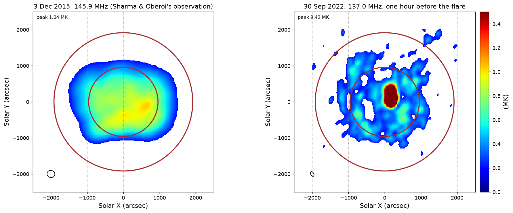
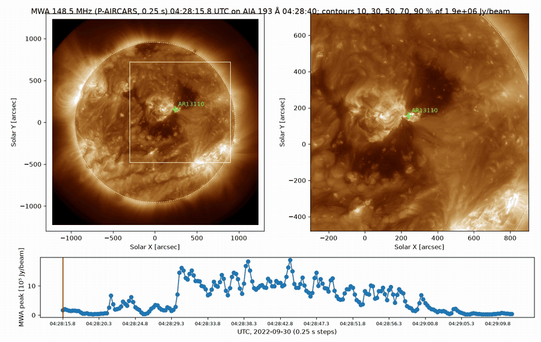
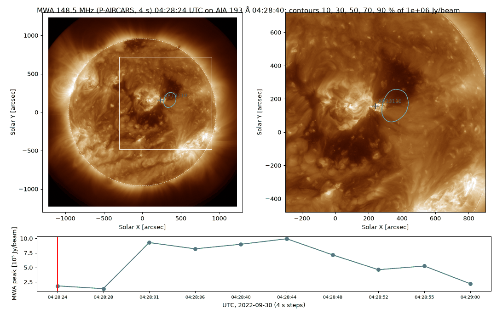
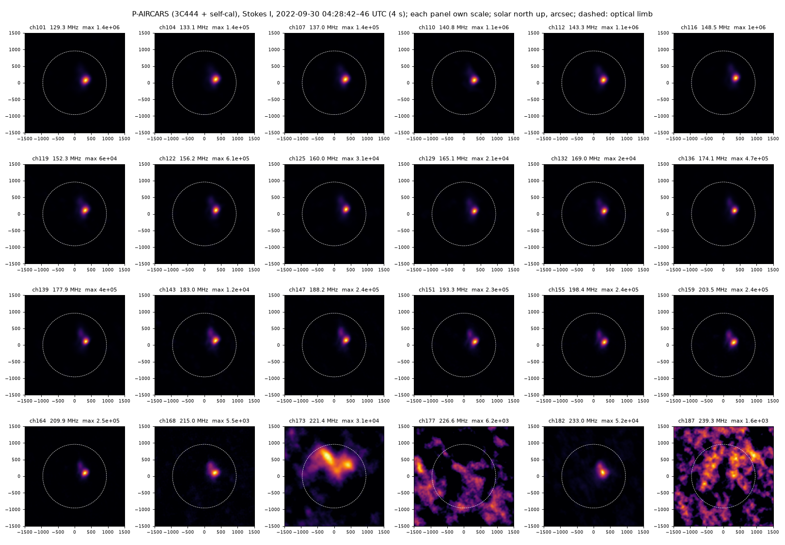
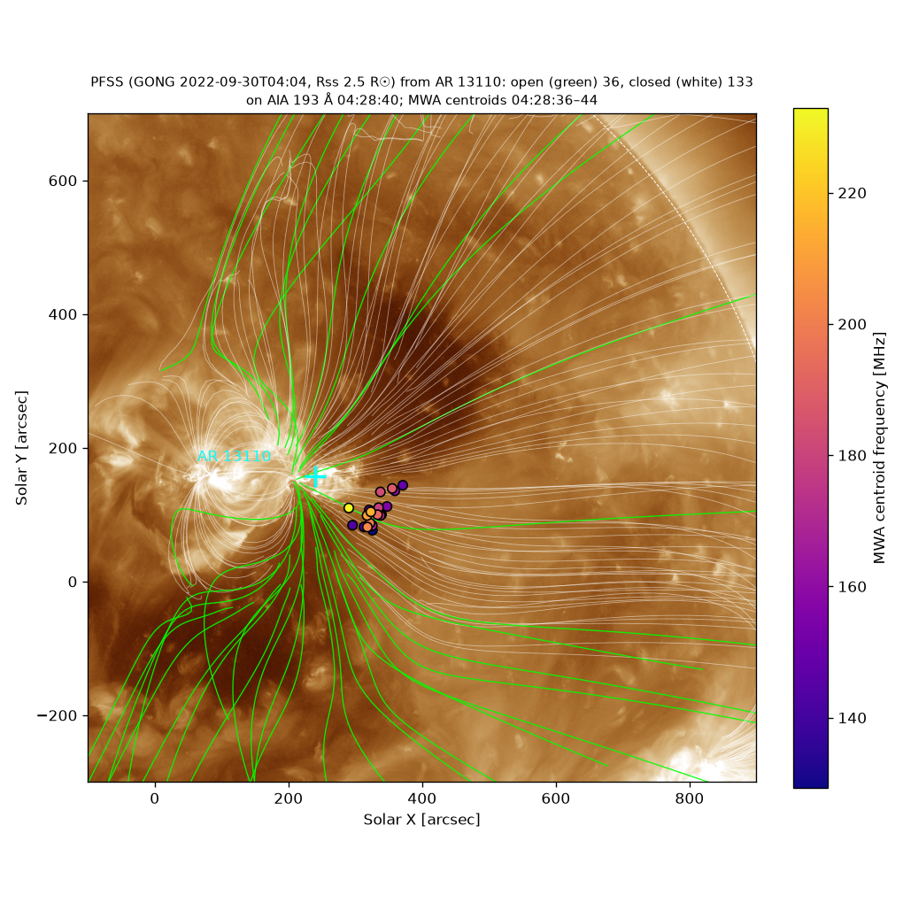
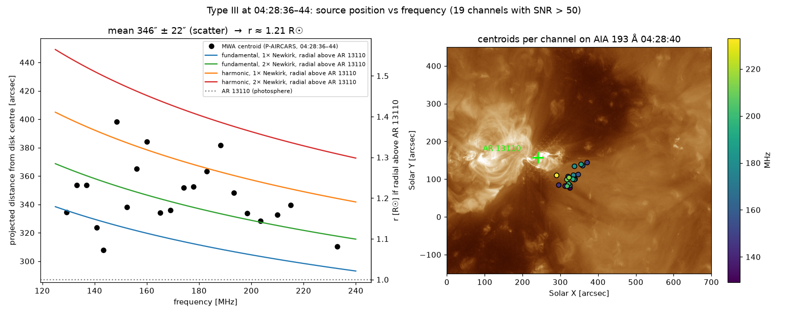
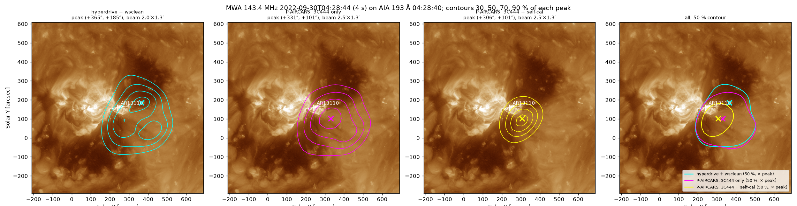
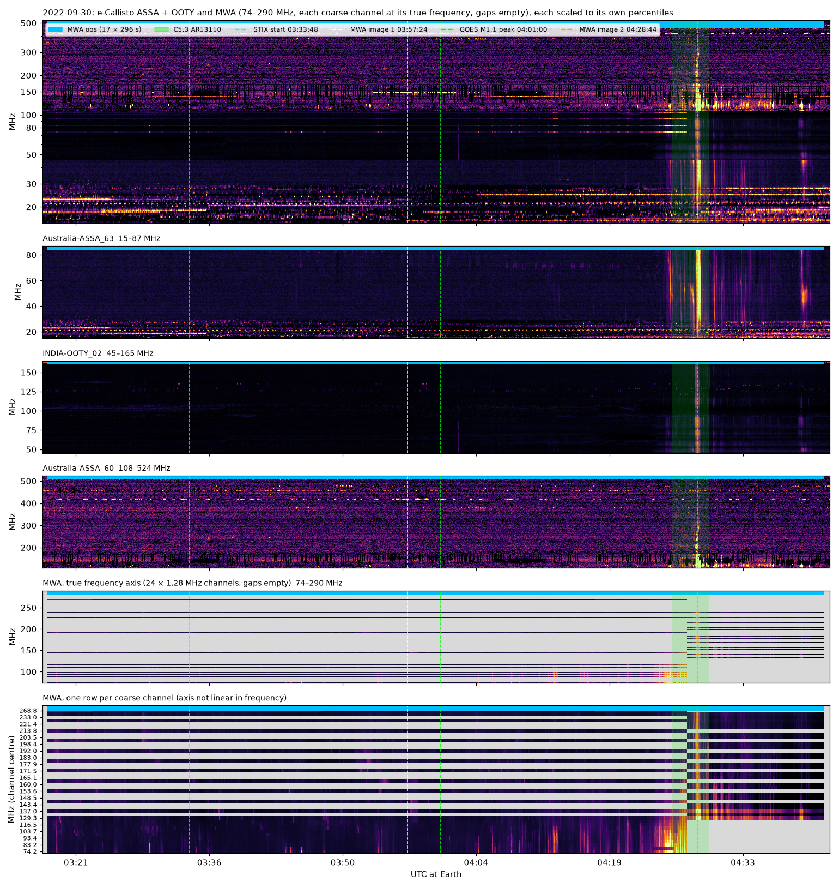

# Solar radio imaging spectroscopy

André Csillaghy's 2026 sabbatical (FHNW, Institute for Data Science): **how
AI-assisted ("agentic") software can help us make and understand radio images
of the Sun.** This page shows the main results so far. The code lives in the
repositories listed at the end.

**Latest status:** [Where we are](#where-we-are).

**Why radio images of the Sun?** When the Sun flares, it accelerates electrons
to high speeds. Some of them race out through the solar atmosphere along
magnetic field lines and make the gas there emit radio waves. The radio
frequency tells us how dense the gas is, and therefore roughly how high above
the surface the emission comes from. Radio telescopes such as the Murchison
Widefield Array (MWA) in Western Australia, and soon the SKA, can take pictures
of this emission many times per second. The data volumes are large and the
processing chains complex, which is where better software, and AI assistance,
can help.

---

## Highlight 1 — Is the brightness right? Checking against a published quiet Sun

*Radio "temperature" maps of the quiet Sun, coloured from 0 to 1.5 million
degrees. Inner circle: the visible Sun; outer circle: twice its radius; small
ellipse: the size of the telescope's sharpest detail. Left: 3 December 2015,
the observation published by the MWA solar team (Sharma & Oberoi 2020), here
processed with our own pipeline. Right: 30 September 2022, one hour before our
flare; the dark red spot is a "noise storm" over the active region, up to
9 million degrees. The two maps are at slightly different frequencies (145.9
MHz in 2015, 137.0 MHz in 2022); the published quiet Sun hardly changes over
that range (0.62 million degrees at 132 MHz, 0.63 at 145 MHz).*

Away from flares the Sun's outer atmosphere glows steadily at radio
wavelengths, at roughly a million degrees, which makes it a natural yardstick
for the brightness scale of our images. To test our pipeline, we downloaded the
very observation the MWA team published and processed it ourselves. The result
matches their published map: a smooth disk somewhat larger than the visible
Sun, at **0.58 million degrees** against their 0.63, and the same bright
patch in the south-west. The pipeline works.

Our 2022 quiet Sun, however, comes out patchy and fainter, at about 0.35
million degrees. Calibrated on the reference source alone, 2015 and 2022
agree (0.37 and 0.42 million degrees). The difference appears in
self-calibration, the step that refines the calibration using the Sun itself:
in 2015 it raises the brightness from 0.37 to 0.58 million degrees, close to
the published value; in 2022 it lowers it from 0.42 to 0.35. A likely reason,
not yet confirmed, is the bright noise storm that dominates the 2022 sky. The patchiness of
the 2022 disk is in the data either way. So the brightness of our 2022 images
is uncertain by a factor of about 1.5–2; their positions are not affected.

## Highlight 2 — Four images per second: the burst flickers (30 September 2022)

*A radio burst seen by the MWA at 148.5 MHz (the one of Highlight 3 below), in
steps of a quarter of a second, the finest time resolution of the MWA: 224
images over 56 seconds, shown at half speed.
Cyan contours: the radio burst at 148.5 MHz; background: the Sun in extreme
ultraviolet (SDO). Bottom: brightness of the burst over time; the red line
marks the frame shown.*

At 4-second steps the burst looked like one smooth rise and fall. Every quarter
of a second it turns out to be a rapid series of flashes, each lasting a second or
less, on top of the slower rise and decay. The source does not move: all
flashes come from the same place, just west of the active region, within a
fraction of the instrument's resolution. For this we downloaded the raw
telescope data (1.1 terabytes for five minutes of observation) and processed it
ourselves. So far only the main burst has been imaged at this rate.

## Highlight 3 — Watching a solar radio burst take off (30 September 2022)

*Cyan contours: a radio burst seen by the MWA at 148.5 MHz, in 4-second steps
over 40 seconds, on top of an extreme-ultraviolet image of the Sun from NASA's
Solar Dynamics Observatory. Left: the whole Sun. Right: a zoom on the active
region (the bright area, marked AR 13110). Bottom: brightness of the burst
over time. The burst switches on within a few seconds, peaks, and fades within
half a minute.*

This was the first solar event we took from the institute's own archive of MWA
observations and processed end to end on our computing cluster (calculon),
from the archived data to calibrated images.

*The same moment at 24 frequencies between 129 and 239 MHz. The burst is clearly
visible in 21 of them, always at the same place, just west of the active
region. (The three noisy panels at the top end of the band did not calibrate
well.)*

## Highlight 4 — How high above the Sun? Following the magnetic field

*Lines: a model of the Sun's magnetic field, computed from a magnetic map of the
solar surface taken 25 minutes earlier. Green lines are "open": they reach out
into interplanetary space, so fast electrons can escape along them. White lines
are closed loops. Dots: where the radio burst is seen at each frequency. The
radio sources sit right on the bundle of open field lines leaving the active
region.*

*Left: distance of the radio source from the centre of the Sun's disk at each
frequency, compared with what standard models of the solar atmosphere predict.
Right: the same positions on the ultraviolet image.*

Two independent methods give the same answer: the burst comes from about
**1.2 solar radii from the Sun's centre, roughly 140,000 km above the visible
surface** (about eleven times the diameter of the Earth). One method uses the
radio frequency and models of how the gas density falls with height; the other
uses where the open magnetic field lines cross the observed positions.

## Highlight 5 — Better images with self-calibration (P-AIRCARS on our cluster)

*The same 4-second radio image produced three ways, on an ultraviolet image of
the active region. Left: standard calibration on a reference radio source.
Middle and right: with P-AIRCARS, a pipeline built specifically for solar MWA
data, without and with self-calibration. Self-calibration refines the
calibration using the Sun itself, which makes the image about 4.5 times
cleaner. All three agree on where the burst is.*

Getting P-AIRCARS to run on our cluster uncovered several software problems in
the pipeline's cluster mode, which we fixed and documented; we plan to offer
the fixes to its developers.

## Highlight 6 — Combining a large radio telescope with a citizen-science network

*Radio "dynamic spectra": frequency (vertical) against time (horizontal) over
about an hour. Bright vertical streaks are bursts of fast electrons. The top
panel combines all instruments; below are stations of e-Callisto, a worldwide
network of small radio spectrometers coordinated at FHNW (Australia and India
here), and the MWA (bottom, twice: each MWA frequency channel at its true
frequency, with gaps where the MWA does not observe, and one row per channel).*

e-Callisto stations observe the Sun around the clock with simple receivers; the
MWA observes only at certain times, but with far higher sensitivity and with
images. Put together, they show which events the small stations catch and
which only the large telescope sees.

Older highlights: [docs/older-highlights.md](docs/older-highlights.md).

---

## Where we are (19 October 2026)

**Season I — imaging (October–December).**

- **Done:** understanding the MWA and its data; the MWA processing software
  running on a laptop, on our cluster (calculon) and at the Swiss National
  Supercomputing Centre (CSCS); reproduction of Sharma et al. 2022; the first
  event from our own MWA archive (30 September 2022) imaged every 4 s, every
  2 s and, for the main burst, every quarter of a second (Highlight 2).
- **The quarter-second burst (12–13 October):** 224 images over 56 seconds at
  148.5 MHz, made from the raw data (1.1 TB) with the solar pipeline P-AIRCARS
  on our cluster. The burst is a series of brightenings: 13 of them stand far
  above the noise, and all come from the same place within 10 arcseconds. A
  brightening just before the burst sits about 120 arcseconds further north.
- **In progress:** the brightness scale (Highlight 1). Our pipeline
  reproduces the MWA team's published quiet Sun of 3 December 2015 (0.58
  against 0.63 million degrees). Our 2022 quiet Sun is fainter (about 0.35):
  calibrated on the reference source alone, both years agree, but
  self-calibration raises 2015 and lowers 2022. The noise storm is a likely
  reason, not yet confirmed. Also in progress: combining MWA with
  e-Callisto, STIX and SDO.
- **Stopped:** quarter-second images of the rest of the flare (before and after
  the main burst). The first of these runs failed on 13 October and nothing had
  run since when we last checked (14 October).
- **Since 16 October:** the archive campaign (plan item 7) has a fixed
  recipe: one image per burst, all at the same frequency (162.6 MHz), 4
  seconds at the burst maximum, with the solar pipeline's self-calibration.
  André reviewed the e-Callisto pictures of the candidates. The data are now
  being requested from the MWA archive: the test case (a type II burst on
  25 December 2024) and 11 of the 16 newest events, which were observed with
  the full 256-tile array. The other 5 are under embargo until 2027–2028 and
  open only to their principal investigator. Nothing has been imaged yet.
  Separately, the SKA simulation package Karabo installs natively on André's
  Mac and simulates on its graphics processor, about 5.6 times faster than
  on the processor (52 s against 290 s); the change stays local. André also
  drafted two bachelor projects for computer science students, for after the
  sabbatical.
- **Next:** the first image from the campaign (25 December 2024), checked
  before the rest run; polarisation, which tells us more about how the radio
  waves are produced; checking the absolute positions.

**SKAO side (plan items 24–27).** First the SKA Science Data Processor (SDP), then
the services of the SKA Regional Centre Network (SRCNet), then a sketch of a
SKA-Low solar pipeline. The solar Detailed Science Case
(DSC-053, dynamic spectra compared with other observatories) now runs end to
end on an MWA observation on the laptop; next is running it on the SRCNet
software stack.

**Season II — e-Callisto (January–March, Mexico)** has not started yet.

The detailed plan is in [docs/sabbatical-plan.md](docs/sabbatical-plan.md), the
latest progress report in [docs/progress-2026-10-09.md](docs/progress-2026-10-09.md),
and the scientific write-up of the 30 September event in
[docs/handover-2022-09-30-science-results.md](docs/handover-2022-09-30-science-results.md).
Work is tracked on the [GitHub Project](https://github.com/orgs/i4Ds/projects/18).

## Repositories

This repository is the map, not the code.

| Repository | What it is for |
|------|------|
| [solar-burst-multiview](https://github.com/i4Ds/solar-burst-multiview) | MWA solar imaging: the reproduction of Sharma et al. 2022, the 30 September 2022 event, P-AIRCARS on the laptop and the cluster, software setup on calculon and CSCS. |
| [STIX-MWA](https://github.com/i4Ds/STIX-MWA) | Combining STIX (X-rays) and e-Callisto with the MWA: STIX images, joint dynamic spectra. |
| [ecallisto_ng](https://github.com/i4Ds/ecallisto_ng) | e-Callisto data access and analysis (Season II). |
| [Karabo-Pipeline](https://github.com/i4Ds/Karabo-Pipeline) | Simulations for the SKA radio telescope. |

## Goals of the sabbatical

The two main goals:

- **A catalogue of solar radio bursts seen by the MWA at high time
  resolution that the e-Callisto network also saw.** Each event is compared
  with X-rays from STIX and GOES, to find which radio bursts have a
  high-energy counterpart (an X-ray flare) and which do not.
- **A comparison of calibration methods for solar radio imaging**: the
  standard MWA tool (hyperdrive), the solar pipeline P-AIRCARS, and Rapthor,
  on the same observations.

These two lead to the ultimate goal: images of all events in the MWA solar
archive. That is very difficult and needs a robust calibration pipeline
first, so we start with the selected events of the catalogue.

Further goals:

- A basis for a doctoral or continuation project (2027–2030)
- An updated e-Callisto analysis package
- A basis for an SNSF and/or EU proposal on e-Callisto data analysis
