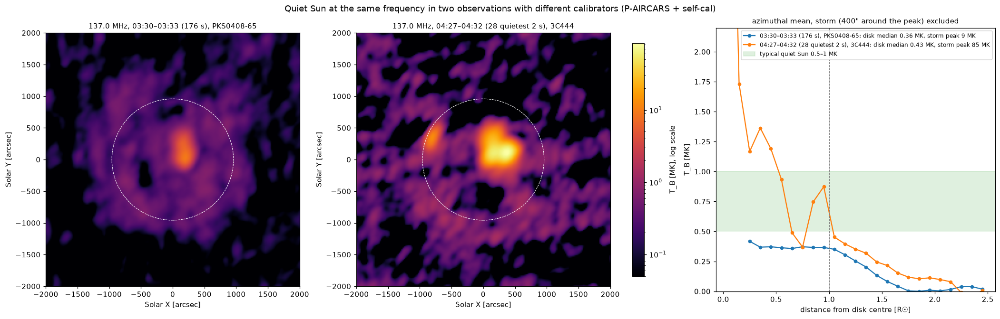

# Solar radio imaging spectroscopy

André Csillaghy's 2026 sabbatical (FHNW, Institute for Data Science): **how
AI-assisted ("agentic") software can help us make and understand radio images
of the Sun.** This page shows the main results so far. The code lives in the
repositories listed at the end.

**Latest status:** [Where we are](#where-we-are).

**Why radio images of the Sun?** When the Sun flares, it accelerates electrons
to high speeds. Some of them race out through the solar atmosphere along
magnetic field lines and make the gas there emit radio waves. The radio
frequency tells us how dense the gas is, and therefore roughly how high above
the surface the emission comes from. Radio telescopes such as the Murchison
Widefield Array (MWA) in Western Australia, and soon the SKA, can take pictures
of this emission many times per second. The data volumes are large and the
processing chains complex, which is where better software, and AI assistance,
can help.

---

## Highlight 1 — Is the brightness right? The quiet Sun as a yardstick (30 September 2022)

*Left: the Sun at 137 MHz on 30 September 2022 at 03:30, an hour before the
flare: a smooth, evenly bright disk, somewhat larger than the visible Sun
(dashed circle), with one brighter spot over the active region. Middle: the
same frequency during the flare (04:27–04:32), using only its quietest moments:
the spot over the active region has grown into a "noise storm" ten times
brighter. Colours are on a logarithmic scale. Right: brightness against
distance from the centre of the Sun.*

Away from flares the Sun's outer atmosphere glows steadily at radio
wavelengths, at roughly a million degrees. That makes it a natural yardstick:
if our images show the quiet Sun at the right brightness, we can also trust the
brightness of the bursts. The two images were calibrated an hour apart on two
different reference radio sources, and where the storm does not interfere they
agree within 15–20 %, at about 0.4 million degrees. The total radio power of the
Sun comes out as expected. The brightness per area is about half of what the
MWA team published for the quiet Sun at this frequency (Sharma & Oberoi 2020),
probably because our images spread the emission over a somewhat larger area.
To settle this we are now processing the very observation they used (3 December
2015) with our own pipeline.

## Highlight 2 — Four images per second: the burst flickers (30 September 2022)

*A radio burst seen by the MWA at 148.5 MHz (the one of Highlight 3 below), in
steps of a quarter of a second, the finest time resolution of the MWA: 224
images over 56 seconds, shown at half speed.
Cyan contours: the radio burst at 148.5 MHz; background: the Sun in extreme
ultraviolet (SDO). Bottom: brightness of the burst over time; the red line
marks the frame shown.*

At 4-second steps the burst looked like one smooth rise and fall. Every quarter
of a second it turns out to be a rapid series of flashes, each lasting a second or
less, on top of the slower rise and decay. The source does not move: all
flashes come from the same place, just west of the active region, within a
fraction of the instrument's resolution. For this we downloaded the raw
telescope data (1.1 terabytes for five minutes of observation) and processed it
ourselves; the images of the rest of the flare are being made now.

## Highlight 3 — Watching a solar radio burst take off (30 September 2022)

*Cyan contours: a radio burst seen by the MWA at 148.5 MHz, in 4-second steps
over 40 seconds, on top of an extreme-ultraviolet image of the Sun from NASA's
Solar Dynamics Observatory. Left: the whole Sun. Right: a zoom on the active
region (the bright area, marked AR 13110). Bottom: brightness of the burst
over time. The burst switches on within a few seconds, peaks, and fades within
half a minute.*

This was the first solar event we took from the institute's own archive of MWA
observations and processed end to end on our computing cluster (calculon),
from the archived data to calibrated images.

*The same moment at 24 frequencies between 129 and 239 MHz. The burst is clearly
visible in 21 of them, always at the same place, just west of the active
region. (The three noisy panels at the top end of the band did not calibrate
well.)*

## Highlight 4 — How high above the Sun? Following the magnetic field

*Lines: a model of the Sun's magnetic field, computed from a magnetic map of the
solar surface taken 25 minutes earlier. Green lines are "open": they reach out
into interplanetary space, so fast electrons can escape along them. White lines
are closed loops. Dots: where the radio burst is seen at each frequency. The
radio sources sit right on the bundle of open field lines leaving the active
region.*

*Left: distance of the radio source from the centre of the Sun's disk at each
frequency, compared with what standard models of the solar atmosphere predict.
Right: the same positions on the ultraviolet image.*

Two independent methods give the same answer: the burst comes from about
**1.2 solar radii from the Sun's centre, roughly 140,000 km above the visible
surface** (about eleven times the diameter of the Earth). One method uses the
radio frequency and models of how the gas density falls with height; the other
uses where the open magnetic field lines cross the observed positions.

## Highlight 5 — Better images with self-calibration (P-AIRCARS on our cluster)

*The same 4-second radio image produced three ways, on an ultraviolet image of
the active region. Left: standard calibration on a reference radio source.
Middle and right: with P-AIRCARS, a pipeline built specifically for solar MWA
data, without and with self-calibration. Self-calibration refines the
calibration using the Sun itself, which makes the image about 4.5 times
cleaner. All three agree on where the burst is.*

Getting P-AIRCARS to run on our cluster uncovered several software problems in
the pipeline's cluster mode, which we fixed and documented; we plan to offer
the fixes to its developers.

## Highlight 6 — Combining a large radio telescope with a citizen-science network

*Radio "dynamic spectra": frequency (vertical) against time (horizontal) over
about an hour. Bright vertical streaks are bursts of fast electrons. The top
panel combines all instruments; below are stations of e-Callisto, a worldwide
network of small radio spectrometers coordinated at FHNW (Australia and India
here), and the MWA (bottom, twice: each MWA frequency channel at its true
frequency, with gaps where the MWA does not observe, and one row per channel).*

e-Callisto stations observe the Sun around the clock with simple receivers; the
MWA observes only at certain times, but with far higher sensitivity and with
images. Put together, they show which events the small stations catch and
which only the large telescope sees.

Older highlights: [docs/older-highlights.md](docs/older-highlights.md).

---

## Where we are (14 October 2026)

**Season I — imaging (October–December).**

- **Done:** understanding the MWA and its data; the MWA processing software
  running on a laptop, on our cluster (calculon) and at the Swiss National
  Supercomputing Centre (CSCS); reproduction of Sharma et al. 2022.
- **In progress:** calibration of MWA solar data; the solar-specific pipeline
  P-AIRCARS, now running on our cluster; the first events from our own MWA
  archive (the 30 September 2022 event above); combining MWA with e-Callisto,
  STIX and SDO.
- **Since 10 October:** the burst of Highlight 3 imaged every 2 seconds
  instead of every 4, then every quarter of a second, the MWA's finest time
  resolution (Highlight 2). For this the raw data (1.1 TB) was downloaded and
  converted for 148.5 MHz; it agrees with the 2-second data to 0.05 %, and no
  burst data is lost to flagging. Images of the whole flare (about 1100
  frames) are being made on the cluster; the main burst is done. The brightness scale was
  checked on the quiet Sun (Highlight 1): two calibrations agree, the total
  power is right; the comparison with published MWA maps is under way.
- **Next:** the quarter-second movie of the whole flare; polarisation, which
  tells us more about how the radio waves are produced; checking the absolute
  positions; more events from the archive.

**SKAO side (plan items 24–26).** First the SKA Science Data Processor (SDP) and
the SKA Regional Centre Network (SRCNet), then the solar Detailed Science Case,
then a sketch of a SKA-Low solar pipeline. The solar Detailed Science Case
(DSC-053, dynamic spectra compared with other observatories) now runs end to
end on an MWA observation on the laptop; next is running it on the SRCNet
software stack.

**Season II — e-Callisto (January–March, Mexico)** has not started yet.

The detailed plan is in [docs/sabbatical-plan.md](docs/sabbatical-plan.md), the
latest progress report in [docs/progress-2026-10-09.md](docs/progress-2026-10-09.md),
and the scientific write-up of the 30 September event in
[docs/handover-2022-09-30-science-results.md](docs/handover-2022-09-30-science-results.md).
Work is tracked on the [GitHub Project](https://github.com/orgs/i4Ds/projects/18).

## Repositories

This repository is the map, not the code.

| Repository | What it is for |
|------|------|
| [solar-burst-multiview](https://github.com/i4Ds/solar-burst-multiview) | MWA solar imaging: the reproduction of Sharma et al. 2022, the 30 September 2022 event, P-AIRCARS on the laptop and the cluster, software setup on calculon and CSCS. |
| [STIX-MWA](https://github.com/i4Ds/STIX-MWA) | Combining STIX (X-rays) and e-Callisto with the MWA: STIX images, joint dynamic spectra. |
| [ecallisto_ng](https://github.com/i4Ds/ecallisto_ng) | e-Callisto data access and analysis (Season II). |
| [Karabo-Pipeline](https://github.com/i4Ds/Karabo-Pipeline) | Simulations for the SKA radio telescope. |

## Goals of the sabbatical

- A working prototype of AI-assisted solar radio imaging
- A basis for a doctoral or continuation project (2027–2030)
- An updated e-Callisto analysis package
- Three to five solar events analysed jointly across instruments
- A basis for an SNSF and/or EU proposal on e-Callisto data analysis
