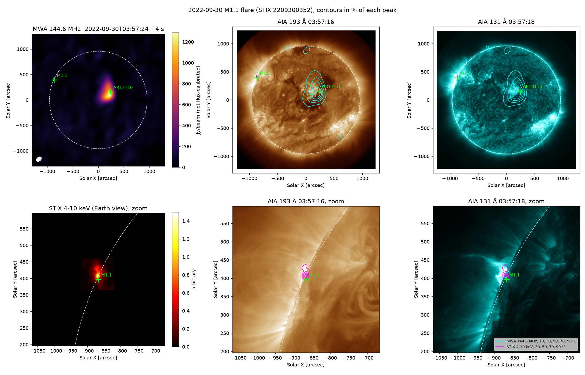
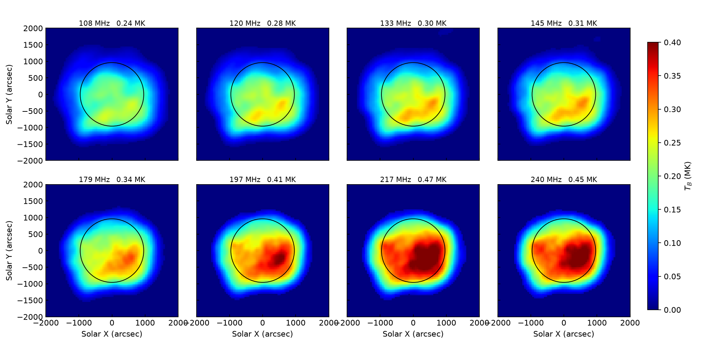
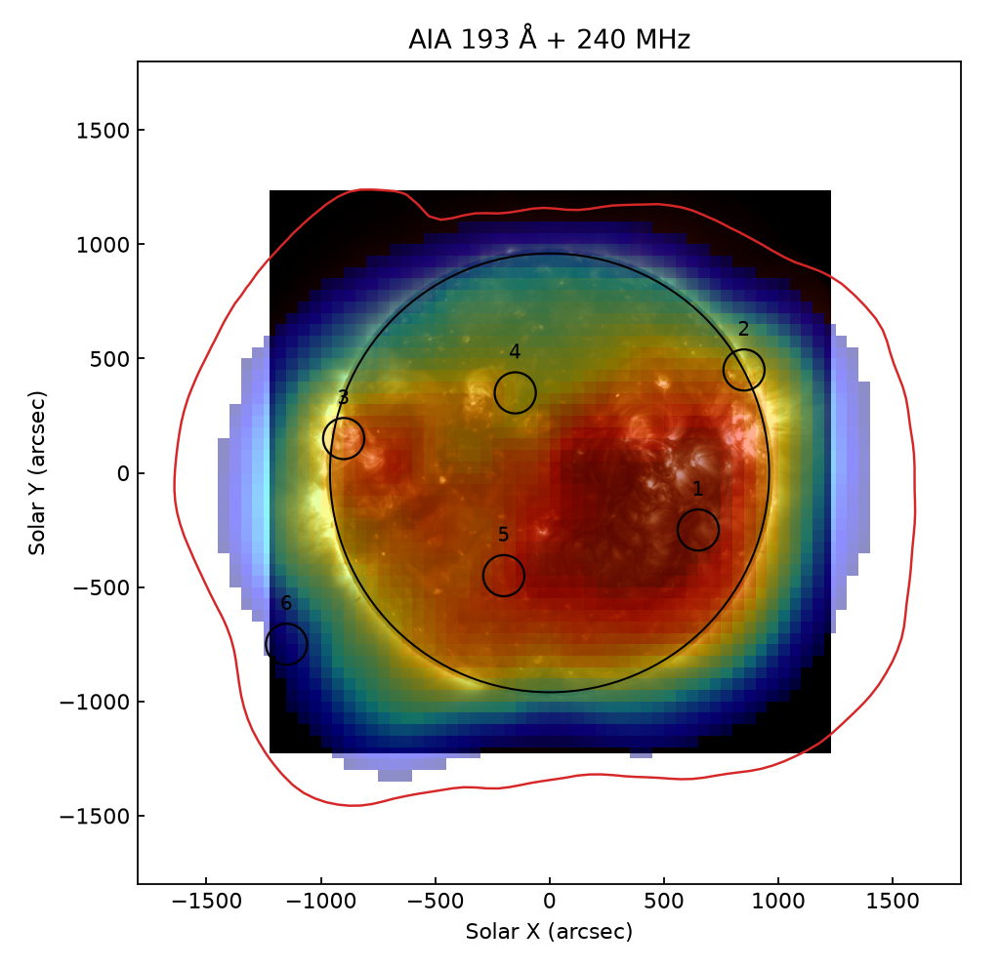

# Older highlights

Earlier results of the sabbatical, newest first. The latest five are on the
[main page](../README.md).

## Three instruments, one picture: radio, X-rays and ultraviolet

*Top: the whole Sun in radio (MWA, left) and ultraviolet (SDO/AIA). Bottom: zoom
on the large flare of that morning at the north-east edge of the Sun, seen in
X-rays by STIX on the European Solar Orbiter spacecraft (magenta contours).*

A larger flare (class M1.1) happened the same morning at the edge of the Sun.
Solar Orbiter was almost exactly behind the Sun as seen from Earth, so its
X-ray telescope STIX saw the flare from the other side. After converting its
image to our point of view, the X-ray source lands within 15 arcseconds
(about 1.5 % of the Sun's radius) of where the flare is seen in ultraviolet.
Interestingly, this large flare was quiet in radio at these frequencies; the
radio activity came from the other, smaller active region near the centre.

## Reproducing a published study

*The radio Sun at eight frequencies between 108 and 240 MHz, rebuilt from the
data of Sharma et al. (2022, Astrophysical Journal 937, 99). Colours show the
radio brightness temperature in millions of kelvin.*

*Radio emission at 240 MHz (colours) over the ultraviolet Sun, with the regions
studied in the paper (circles).*

As a first step we rebuilt the figures of a published MWA study from its
original data products. This is how we learned the instrument, its data and its
processing tools.
